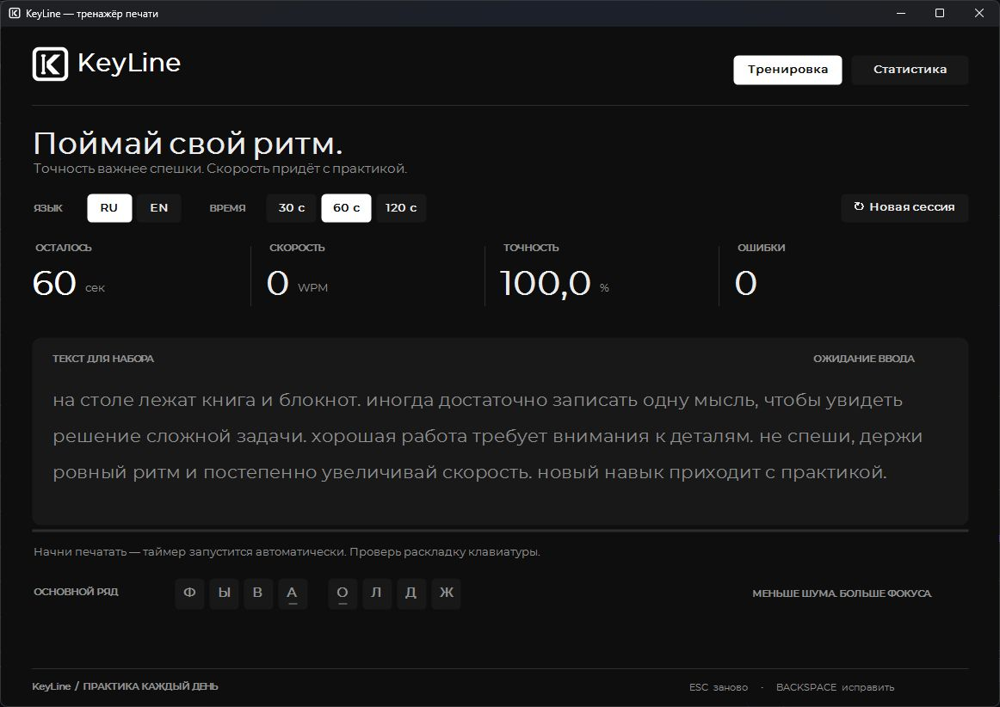
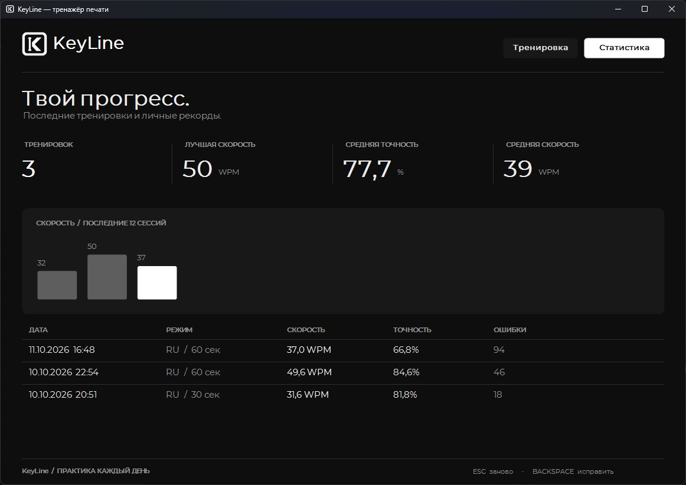

# KeyLine

**Тренажёр слепой печати с акцентом на скорость, точность и привычку заниматься.**

Windows x64 · C# · .NET 8 · Windows Forms · Montserrat

Выберите язык и длительность, начните печатать — KeyLine сам запустит таймер,
покажет ошибки и сохранит результат. Монохромный интерфейс помогает сосредоточиться
на тексте, а статистика показывает, как меняется скорость от тренировки к тренировке.



## Возможности

- **RU и EN** — тексты для русской и английской раскладок.
- **30, 60 или 120 секунд** — короткая практика или длинная тренировка.
- **WPM, точность и ошибки** — показатели обновляются во время набора.
- **Исправление опечаток** — Backspace, подсветка ошибок и позиция текущего символа.
- **История и график** — личный рекорд, средние показатели и последние результаты.
- **Локальная работа** — история хранится рядом с программой, интернет не нужен.

## Статистика



Скриншоты сделаны в работающем Windows-приложении.

## Собрать и запустить

Нужны **Windows** и **.NET 8 SDK**. В PowerShell:

```powershell
git clone https://github.com/reallynigeuteg7-ux/KeyLine.git
cd KeyLine
dotnet publish Keyline.csproj -c Release -r win-x64 --self-contained true -o ..\Keyline-Windows
..\Keyline-Windows\Keyline.exe
```

Собранная версия включает .NET Runtime. Для переноса на другой компьютер
скопируйте **всю папку `Keyline-Windows`**, включая `Assets` и библиотеки.
Для подготовленной среды на диске D также есть [build.ps1](build.ps1).

## Начать тренировку

1. Выберите RU / EN и время сессии.
2. Переключите системную раскладку на язык упражнения.
3. Начните вводить показанный текст — таймер стартует первым символом.
4. Исправляйте ошибки Backspace; после окончания времени результат сохранится.

| Клавиша | Действие |
| --- | --- |
| Backspace | Исправить предыдущий символ |
| Esc | Сбросить попытку |
| Enter после завершения | Начать новую тренировку |

Скорость рассчитывается в WPM: пять верных символов считаются одним словом.
Точность учитывает все печатные нажатия, поэтому исправленная опечатка остаётся
в показателе точности. Подробные формулы — в [руководстве](docs/GUIDE.md).

## Как устроен проект

| Файл | Назначение |
| --- | --- |
| [TrainerForm.cs](TrainerForm.cs) | Отрисовка интерфейса и обработка ввода |
| [Session.cs](Session.cs) | Сессия, тексты, формулы и история |
| [Program.cs](Program.cs) | Запуск приложения |
| [Assets/](Assets/) | Логотипы, иконки и локальные шрифты |

История хранится в `Data/history.json` рядом с exe; папке программы нужен доступ
на запись. Аккаунты, синхронизация и установщик не предусмотрены.

**Документация:** [подробное руководство](docs/GUIDE.md) ·
[логотип и иконки](Assets/README.md) · [лицензия Montserrat](Assets/Fonts/OFL.txt).
